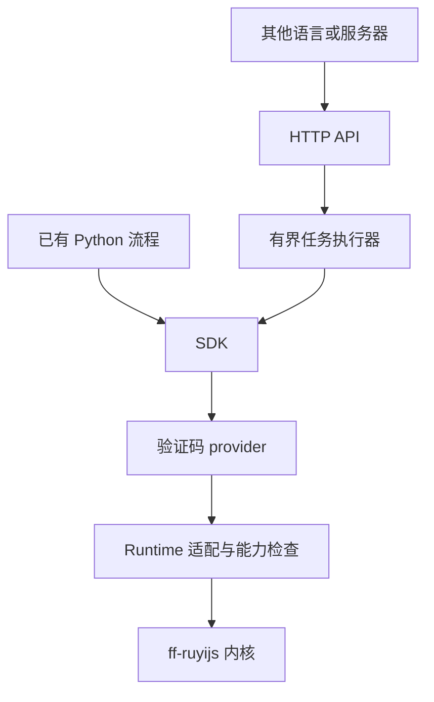

# 内核与验证码应用层的边界

建议采用两个仓库：ff-ruyijs 负责 JavaScript、浏览器语义和网络运行时，ruyi-captcha
负责验证码适配、Python SDK、HTTP API 和任务生命周期。两种调用模式共用同一个
provider 实现，避免本地调用与服务调用逐渐出现行为差异。

## 为什么适合当前项目

上游 0.3.5 提供了 DOM、布局和内存优化，但没有本次验证所需的 Trusted Types 默认转换。
保持少量、具有独立回归的原生补丁，可以继续获得上游的平台支持和通用优化。
验证码厂商参数、回调、重试策略和站点流程变化更快，放在外围能独立测试和发布。

本次内核已从上游 `0ab7201` 重建，只增加两组原生能力提交：Trusted Types 转换及
线程隔离；closed Shadow DOM 宿主访问及 iframe 输入坐标/焦点。旧完整 fork 已保存到
`backup/main-full-20261107`。内核 main 已推送，新增提交使用 Starktomy 的 noreply 身份，
Codex 为共同作者。

## 具体放在哪里

| 内容 | 所在仓库 | 判断依据 |
| --- | --- | --- |
| SpiderMonkey、Necko、DOM/CSS、时钟、Worker、Engine | ff-ruyijs | 多种网站共同依赖的运行时能力 |
| Trusted Types/CSP、微任务时序、iframe 输入与宿主检查 | ff-ruyijs | 浏览器标准行为或宿主自动化能力 |
| 通用字体、布局、内存优化及其正确性回归 | ff-ruyijs | 以性能测量和浏览器行为一致性验收 |
| `configure_fingerprint` 配置机制与字段语义 | ff-ruyijs | 通用环境控制接口 |
| 具体环境 profile、选择策略、proxy 配置 | ruyi-captcha | 随任务和目标环境变化的输入 |
| Turnstile 的 sitekey、action/cData、回调和错误分类 | ruyi-captcha | 验证码协议适配 |
| SDK、HTTP 路由、任务队列、幂等、期限和结果存储 | ruyi-captcha | 应用与服务运行职责 |
| OCR、图片定位、点选、滑块及模型管理 | ruyi-captcha | 识别和决策模块 |
| 实时验证码及目标后台接受测试 | ruyi-captcha | 端到端产品验收 |

这个边界按职责划分。内核中的 Python Context、协议和进程管理继续属于内核，
外围的 provider 也可以调用将来独立运行的识别组件。

## 两种模式和一次实现

SDK 的 `solve_turnstile()` 直接返回 token，详情函数返回耗时和尝试次数。
HTTP API 使用相同的详情函数执行任务，既提供同步等待，也提供提交、查询和取消。
远程 Python `ApiClient` 只依赖标准库，可在没有内核的机器上使用。

当前代码对应关系：

- `sdk.py`：本地调用与类型分派。
- `providers/turnstile.py`：从旧 fork 迁入并补充取消支持的 Turnstile 驱动。
- `runtime.py`：内核导入、能力探针与构建散列；集中处理与内核的接口联系。
- `jobs.py`：容量、排队期限、幂等、协作取消和结果期限。
- `api.py`：请求验证、鉴权和 HTTP 协议。
- `client.py`：远程客户端。

后续新增验证码类型时增加 provider 和对应请求模型、回归用例；只有遇到明确的
浏览器行为缺陷时，才在内核补充通用实现和最小复现。

## “各种验证码”的现实范围

| 场景 | 内核的作用 | 外围还需要的能力 |
| --- | --- | --- |
| Token / JavaScript 验证 | 执行脚本、维持 realm/网络/环境 | 参数与回调适配、状态机、结果交付 |
| 图片文字 | 加载资源和执行站点流程 | OCR、文本校验和业务提交 |
| 点选、滑块 | 执行交互、提供元素和坐标语义 | 图像定位、交互策略和后台验收 |
| 强依赖页面像素的挑战 | 提供现有 JS/DOM/Canvas 能力 | 先验证资源和图像获取是否足够 |

ff-ruyijs 没有 GUI 和完整页面渲染器，不能从已有 Turnstile 成功样本推导所有视觉型
挑战都可支持。第一版明确只开放 Turnstile；新的类型应逐个增加真实验收样本。
不同类型的输出也可能是 token、识别文本或已完成验证的会话，需要按类型扩展结果模型。

## 验收与结果语义

当前 API 的 `verification_status=token_obtained` 只表示取得 token。后台接受需由
业务端回执或受控的端到端测试确认。服务不要求调用方把站点 secret 交给通用求解器。

任务有三个不同的时间边界：排队期限、每次尝试预算、完成后结果保留期限。
验证码本身的有效期由厂商决定。Turnstile 文档规定 token 5 分钟有效、只能验证一次；
reCAPTCHA 文档规定 2 分钟、只能验证一次。因此，结果应及时交付，服务端 TTL 也不能
被当成厂商有效性的保证。
[Turnstile 验证文档](https://developers.cloudflare.com/turnstile/get-started/server-side-validation/)，
[reCAPTCHA 验证文档](https://developers.google.com/recaptcha/docs/verify)。

实时验收应同时记录 token 返回、后台接受、失败码和实际环境。耗时分别报告 token
取得与后台提交；资源成本应包含失败尝试。样本规模、内核构建、profile、proxy 和
并发数要随结果保存，便于重现和比较。

## 并发和故障边界

第一版 API 使用单进程、有界工作线程池；每次尝试创建独立 Context 和原生进程。
这样 API 层可以统一限流，单个原生进程崩溃也不会结束其他任务。
SDK 仍可在调用方的 `use_engine(engine)` 中运行。共享 Engine 降低进程开销，但一个
引擎进程崩溃会结束其所有会话；是否共享由外围按任务量和隔离需求选择。

任务池同时限制运行和等待数量。取消排队任务后，直到工作线程取走对应队列项，
它仍占用实际容量，避免反复取消/提交积累无界的 executor 队列。
运行任务在下一次请求边界检查取消标记，当前 native RPC 仍受自己的超时限制。

队列、幂等记录和结果目前都在内存中，服务重启后清空。多实例和故障恢复应在下一阶段
增加共享任务存储、执行租约和持久化状态；验证码 provider 可以保持原来的实现。

## 为什么完整页面慢，而 sitekey + URL 快

本次精简内核的完整 CapSkip 页面三次通过后台验收，耗时约 108–110 秒；最小组件
路径约 4 秒。完整页面加载了更多 DOM、样式和脚本，执行内容与最小组件不同。
44 秒诊断区间采到约 47 秒进程树 CPU 时间，两个可解析的 native 栈落在 CSS 样式
计算和布局遍历，说明这是明确的本地计算热点。

上游 0.3.5 优化了 wrapper 查找、属性读取、查询和部分样式缓存；旧 fork 的组合布局、
样式和字体缓存覆盖了额外路径。后续可对通用热点逐项恢复或改进，但应保留上游优化，
并重新验证 DOM/CSSOM 变更、跨 realm、并发和 GC 后的正确性。
当前服务优先采用已验证的 `site_url + sitekey` 路径。需要原页面上下文的适配器，
再使用完整页面路径并单独设置性能预算。

## 如何跟进上游和发布

内核保持少量主题清晰的兼容补丁，每个补丁有独立回归；在候选集成分支上跟进上游，
依次通过离线能力、并发会话、网络及外围真实验证码验收后，再推广新构建。
上游吸收了对应修复后，可撤掉私有实现并继续保留回归。

外围发布应锁定内核提交和二进制构建，而不仅是 `ruyijs.__version__`。
原版与本次 patched runtime 都标为 0.3.5，但能力不同，所以启动探针会检查实际的
Trusted Types 和可信输入行为。构建时记录 kernel commit、upstream base、helper
版本、平台和 SHA256；线上升级、回滚使用不可变的 wheel/镜像产物。
兼容的私有修订可使用 `0.3.5+compat.1` 这样的本地版本标识；公开索引的规则不同，
具体遵循 [Python 版本规范](https://packaging.python.org/en/latest/specifications/version-specifiers/)。

当前应用 wheel 为纯 Python，内核仍需要匹配目标平台的原生 wheel。复制本机原生
可执行文件到另一种系统版本，不等同于完成了可移植发布。

## 许可证与下一阶段

拆仓库改善工程边界。复制的求解器代码仍须保留其许可，仓库或进程数量不能单独决定
许可证范围。当前应用沿用 AGPL-3.0-only；内核的商业许可见其原始说明。
对外服务与闭源方案需要结合实际代码来源、组合方式和授权条款确认。
[AGPL 第 13 节](https://www.gnu.org/licenses/agpl-3.0.en.html#section13)，
[GNU 关于程序组合的说明](https://www.gnu.org/licenses/gpl-faq.html#MereAggregation)。

优先演进顺序是：稳定当前 SDK/API 和端到端验收；补充并发下的成功率、CPU/PSS、
P95 延迟和失败成本；选择下一个具体验证码类型；在确有多实例需求时增加共享队列
和结果存储。视觉模型有独立资源需求后，再引入专用工作进程。
